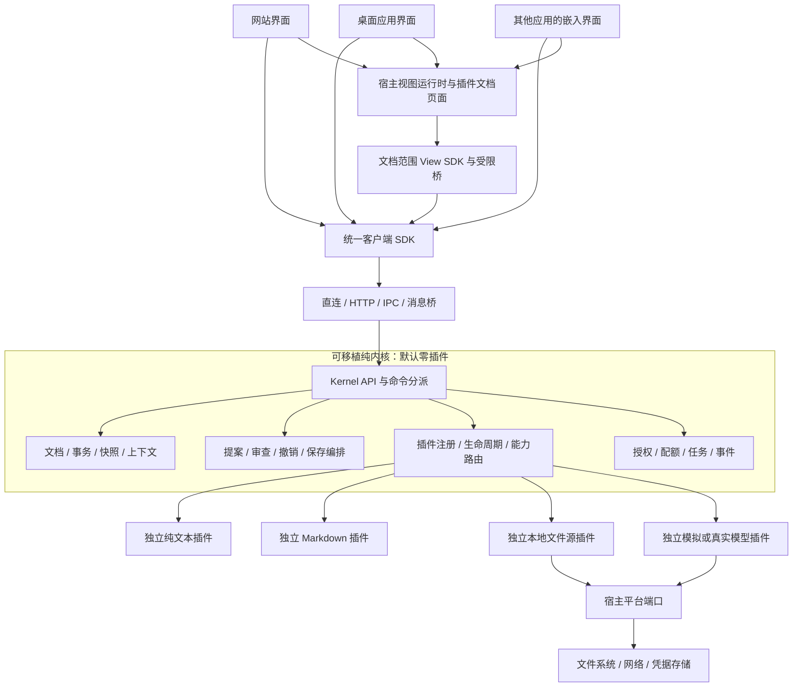

# 架构设计 v0.3：纯内核、插件文档页面、多宿主

状态：**架构方案，尚未实施**。更新日期：2026-11-09。Demo 源码基线：`3e317f0`；修订基于 v0.2 设计提交 `c47b07f`。

本版按用户明确方向修订：**内核默认零插件；业务接口与权威状态集中在内核；插件可以决定受支持文件在工作空间中的页面和交互，并复用内核的引用、关注、聚焦能力。** 本文替代 v0.2 中仅允许预览数据、不允许插件 UI 的限制，保留其纯内核方向。当前可运行 Demo 仍见 [项目 README](../../README.md) 和 [demo.md](../../demo.md)。

## 1. 架构结论

**首要原则：插件专注于文件的理解、呈现和专属操作；内核组织这些插件，托管文档状态，并提供统一的文件操作入口与保存管理。**

内核是可独立使用的产品模块。它提供文档事务、版本、源选区、上下文、修改提案、任务编排、权限和插件生命周期的统一接口；具体格式、文档页面、数据源和模型协议由我们逐个设计的插件提供。插件拥有文件区域的呈现与交互，工作台拥有标签、分栏及全局确认入口。

新增一种文件能力时，优先通过插件接入已有入口；跨文件类型共享的状态、操作规则和协作契约集中在内核。插件无需各自建立工作空间、保存管理或引用/关注/聚焦系统，工作台也无需为每种文件重写操作流程。

网站是第一个宿主。迁移到桌面壳或其他应用时复用 **内核 + 所选插件 + SDK**，接入相应传输与平台适配器。UI 可复用或替换，无需重写编辑和审查规则。纯内核包不携带 Markdown、纯文本、磁盘或模型插件实现。



图中插件都须独立实现并显式装配，不是内核自带能力。内核通过能力路由调用插件并校验输出，插件不得直接改内核对象。平台端口封装宿主机制，具体文件或模型协议留在插件。

## 2. 四种边界

| 边界 | 所有职责 | 不包含 |
| --- | --- | --- |
| Kernel | API、文档/版本/事务、通用文本范围、上下文、提案、审查策略、撤销、保存编排、任务、授权、插件管理与事件 | 具体插件、React/DOM、CodeMirror 对象、HTTP 服务器、Node I/O、模型 SDK |
| Plugin | 无界面格式能力、独立文档页面与交互、资源源协议、模型协议、格式命令 | 直接改权威状态、绕过版本/关注/范围检查、将引用升级为目标、接管全局权限 |
| Host Adapter | 已授权资源句柄、OS 操作、网络、凭据存储、执行容器、身份认证、消息通道、原生对话框 | 聚焦、应用、撤销、保存等业务决策 |
| 工作台 / 视图运行时 | 标签、分栏、全局上下文与审查入口、插件页面容器、输入协调、主题与消息桥 | 唯一文档真相、私自应用提案、直接保存、第二套目标选择逻辑 |

“干净”指没有具体插件和宿主依赖，不等于没有通用编辑规则。text/v1 的字符串事务、版本和精确范围是内核基础模型；`.txt` 的识别、编解码、段落划分和导出是插件行为。首期只承诺 text/v1，复杂文档需新增明确模型契约，不能开放任意可变对象。

## 3. 零插件启动

`createKernel({ platform, pluginLoader })` 只初始化内核，插件清单为空；不扫描目录、不加载默认插件、不监听端口、不读用户文件、不调用模型。

零插件时可以创建会话、查询 API/能力、管理空注册表、创建内存 text/v1 文档并使用通用事务。不能识别/打开 `.md` 或 `.txt` 文件、解析 Markdown、浏览磁盘、写文件源、调用模拟或真实模型；返回 `CAPABILITY_UNAVAILABLE`，UI 显示缺少的能力。文档视图贡献也为空，宿主诊断面板不属于内核自带插件。

产品启动配置可以显式选择插件和启用项，组成网页或桌面发行组合；发行组合不是内核依赖。自己开发的插件与以后允许的其他插件使用相同注册、版本、权限和生命周期契约，不因作者身份获得隐藏特权。

## 4. 三套公共契约

| 契约 | 使用者 | 目的 |
| --- | --- | --- |
| Kernel API | 网页、桌面、嵌入宿主、无 UI 测试客户端 | 全部通用业务方法、状态快照与事件 |
| Plugin SDK（含 View SDK） | 每个独立插件的无界面/视图入口 | 扩展声明、受限能力、文档范围 UI 调用和各自生命周期 |
| Host Ports | 平台/传输适配器 | 时钟、随机数、摘要、资源操作、凭据、网络、执行机制 |

接口以可序列化 schema 和方法目录为准，生成或校验类型、输入校验和文档；静态类型不能代替运行时校验。同进程直连也经过统一分派器的身份、版本和权限校验。

API 命名如 `documents.transact`、`context.focus.create`、`proposals.apply`、`documents.save`、`plugins.enable`。HTTP 路径只是映射，业务接口不绑定某种传输，见 [内核接口](kernel-api.md)。

## 5. 权威状态归内核

DocumentStore、保存基线、撤销历史、引用快照、关注、聚焦、计划、提案和任务都由内核持有。UI 只有只读投影和未确认输入队列；IME 组合文本与光标属于展示层。未确认投影不能当作已提交或已保存状态。

内核作为“保存的地方”包含两层职责：托管当前文档及已确认修改，并统一管理保存目标、保存任务和结果。实际持久存储由已装配的资源源插件和宿主端口执行；类型插件负责编码，视图插件发出操作请求。内核不因承担保存管理而内置磁盘实现，也不把内存草稿等同于已落盘或可在重启后恢复。

输入经 documents.transact 提交，内核串行校验版本并发布事件。编辑组件负责交互与位置展示，业务 undo/redo 由内核统一执行。保存、生成、应用和关闭前 SDK 排空输入队列并携带最后确认版本。

首期一个 documentId 只有一个写入租约，并绑定输入拥有者 writerId（页面对应 viewId），其他视图只读订阅。同一磁盘文件仍可有不同 documentId 的独立缓冲区，以资源版本防止相互覆盖；不引入多人实时协作或 OT/CRDT。输入队列、租约、重连详见 [数据契约](contracts.md)。

内核与视图生命周期分离：一个会话可接多个宿主连接；关视图不直接关文档，失联不丢草稿。浏览器刷新可重连仍存活的内核会话；内核重启恢复是后续持久化能力，不能与刷新恢复混为一谈。

## 6. 首批插件需单独实现

下列名称是暂定设计 ID，尚未实现插件包：

| 插件 | 能力 | 无权承担 |
| --- | --- | --- |
| editor.text | `.txt` 编解码、段落分块；独立文本编辑页面与选取交互 | 磁盘和模型访问 |
| editor.markdown | 无 DOM 的 `.md` 编解码/结构；独立源码/阅读页面、结构选择与可选预览树 | 在无界面入口依赖 DOM、执行文件内脚本、自动加载网络资源 |
| editor.source.local | 授权根枚举、资源读取、版本化保存、变化通知 | 格式判断、未授权路径访问 |
| editor.model.simulator | 当前固定规则模拟及明确模拟标记 | 网络、凭据、真实语义理解承诺 |
| 真实模型协议插件（待命名） | 配置 schema、输入适配、流/响应解析、能力声明 | 文件权限、扩大发送范围、直接应用/保存 |

宿主把主动选择的字节交给 documents.import，由内核路由类型插件；documents.export 产生制品，宿主负责下载/原生另存并报告结果。无匹配插件时不自动套用纯文本。两种文本插件可复用普通 UTF-8 工具库，但库不注册能力，内核不依赖它。

插件 manifest、扩展点、权限、生命周期、卸载和故障策略见 [插件协议](plugin-system.md)。页面归属、视图选择、View SDK、精确源映射及生命周期见 [文档视图](document-views.md)。

## 7. 通用业务闭环全部经内核

1. documents.open/import 通过资源/类型插件建立缓冲区。
2. documents.transact/undo/redo 统一事务和版本。
3. views.* 管理文档页面绑定，selections.* 校验插件从交互映射的精确源范围；context.* 统一管理引用、关注、聚焦；documents.blocks 调插件分块。
4. plans.prepare 读取内核快照生成发送清单，确认后 runs.start 调模型插件。
5. proposals.compare/apply/discard 统一差异、校验和审查策略，插件只返回候选。
6. documents.save/export 编排编码与保存；应用仍不写磁盘。

工作台窗口和全局确认 UI 由宿主实现，文件页面、光标和局部选择交互可由插件实现；内核返回待确认状态及版本绑定的票据，宿主展示后提交确认，插件不能替用户确认。选中内容本身不创建关注；人工编辑不要求 AI 关注，模型提案仍受关注及范围约束。

保留 Demo 的 accept-on-next-action 策略：实际输入、保存或该文档下一次生成才触发先应用；切标签、看差异、改请求不触发。规则在内核，宿主只发送真实操作意图。

## 8. 可移植性与宿主适配

建议先以不依赖宿主 API 的 TypeScript/ES modules 实现内核，以 Node 本地宿主为首个适配。内核不得直接导入 Node、DOM、WebView 或桌面壳包；必要机制经最小 Host Ports 注入，缺端口/插件时通过能力发现降级。

| 部署形式 | 内核运行位置 | 需提供的适配 |
| --- | --- | --- |
| 网页 + 本地服务 | 本地进程 | Node 平台端口、HTTP/SSE、网页 UI |
| 桌面应用 | 桌面进程或附属进程 | IPC、原生资源/下载/凭据端口，可复用网页 UI |
| 嵌入其他应用 | 宿主可用进程或独立本地服务 | 宿主授权资源桥、身份与消息通道 |
| 仅浏览器演示 | 支持的本地运行容器 | 内存、导入/导出和可用插件，不承诺任意磁盘能力 |

迁移时须带上兼容插件和适配器，并通过相同契约测试，不承诺一个二进制在全部环境即插即用。不支持 JavaScript 的宿主可调用独立内核进程。Web 文档视图可在经验证的网页/WebView 运行时复用；纯原生宿主需要相容的视图实现或容器，不能只迁移内核就获得网页 UI。React/Vite/CodeMirror 只是视图候选，不是内核先决条件；桌面框架留待宿主需求确定。

嵌入默认经受认证的 SDK/消息桥。需要 iframe 时另设明确的 frame-ancestors、来源白名单和握手，不放宽现有 Demo 的 DENY/CSP，不对任意跨域页面开放内核。

## 9. 建议包结构

以下代码包尚未创建：

```text
packages/
  kernel/          # 纯内核，只依赖契约及普通通用库
  contracts/       # 方法、DTO、事件、错误、运行时 schema
  plugin-sdk/      # 无界面声明/上下文，依赖 contracts
  view-sdk/        # Plugin SDK 的 UI 入口，文档范围调用与生命周期
  client-sdk/      # 调用、投影、队列与重连，不复制业务服务
plugins/
  text/
  markdown/
  source-local/
  model-simulator/
adapters/
  host-node/       # OS、网络、凭据等平台机制
  view-web/        # Web 插件页面容器、受限桥及输入协调
  transport-http/
  transport-ipc/   # 在宿主需要时实现
apps/
  web/            # 工作台外壳、全局上下文/审查和通用展示组件
  local/          # 装配内核、插件、适配器的启动器
distributions/    # 选择插件与权限的发行配置
test/             # 内核、插件、宿主一致性及 Demo 回归
docs/architecture/
samples/          # 仅虚构样例
```

插件无界面部分依赖 plugin-sdk/contracts，视图入口依赖 view-sdk/contracts，均不导入 kernel 内部；工作台通过 client-sdk 调内核，插件页面只拿文档范围 façade；启动器显式组合。核对打包依赖闭包，确保内核不含具体插件、DOM、宿主模块或隐式自动注册。

## 10. 迁移顺序与版本变化

顺序改为：**内核 API → 零插件内核 → 首批独立插件 → 现有网页接入 → 第二宿主验证 → 真实模型/恢复**。先由无 UI 客户端完成编辑闭环，再优化网页框架。

本轮只修订设计，未实现内核/插件/接口或改动运行代码。v0.1 的浏览器业务状态和内置类型处理器已被 v0.2 替代；v0.3 在纯内核方向上新增插件文档页面，替代 v0.2 的禁止可执行 UI 和仅预览树策略。Demo 行为与测试仍是迁移依据。

- [内核接口](kernel-api.md)：方法目录、分派、事件、确认与传输。
- [插件协议](plugin-system.md)：manifest、扩展点、权限、生命周期和首批设计。
- [文档视图](document-views.md)：插件页面、View SDK、源选区、切换与跨宿主复用。
- [数据契约](contracts.md)：权威状态、同步、版本、提案。
- [迁移计划](implementation-plan.md)：阶段验收与回退。
