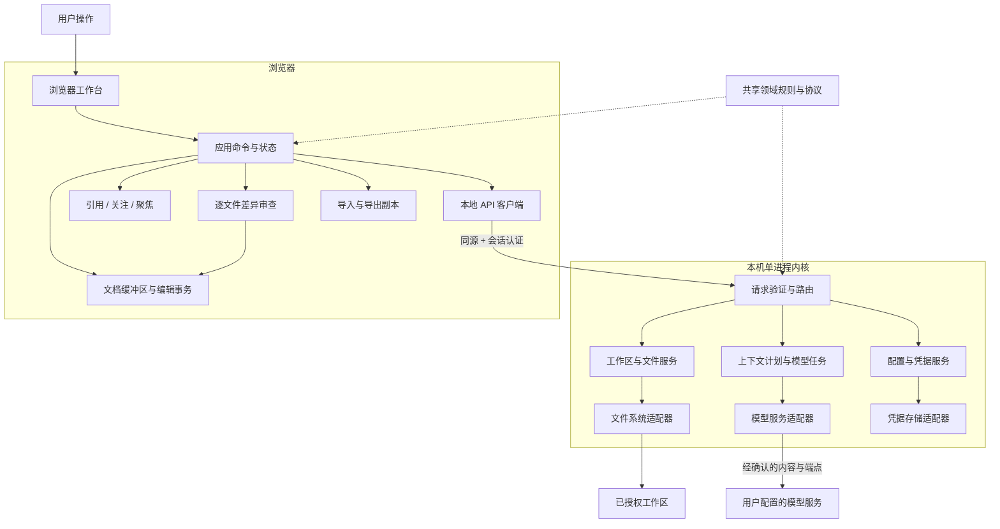
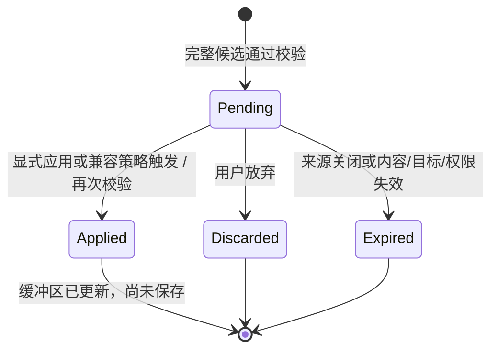

# 架构设计 v0.1

状态：**建议方案，尚未实施**。设计日期：2026-11-09。代码基线：`3e317f0`。

本设计依据 [demo.md](../../demo.md)、[当前能力说明](../../README.md) 和现有源码。Demo 的临时范围不等于产品的全部需求；后续已经落地的交互同样属于迁移依据。本文提出工程化方向，不改变当前启动方式、文件权限或模型行为。

## 1. 结论与范围

建议采用 **浏览器工作台 + 本地模块化内核 + 共享领域规则**。首期继续单用户、单本地进程部署，保持离线模拟可用；将文件访问、编辑缓冲区、修改审查和模型通信分别管理。

核心约束是：**关注决定哪些文档可以改，聚焦决定可改范围，引用提供只读快照；模型只提出修改，应用只更新缓冲区，保存才写磁盘。**

| 层次 | 建议选型 | 本项目的理由与代价 |
| --- | --- | --- |
| 浏览器工作台 | TypeScript + React + Vite | 面板、标签、聚焦草稿和审查界面需要独立状态与生命周期；引入构建和依赖管理，按功能迁移 |
| 文本编辑 | CodeMirror 6，通过 EditorAdapter 接入 | 使用编辑事务、选区和扩展机制承接撤销、位置映射；先验证中文输入、双栏和焦点行为 |
| 本地内核 | TypeScript + Node.js，先保留原生 HTTP | 复用现有文件和鉴权代码，不为首期增加第二种后端语言或多进程服务 |
| 公共规则 | 无 DOM、文件系统和网络依赖的领域模块 | 让前后端使用相同的范围、版本和提案校验；模块只能通过显式端口获得外部能力 |
| 协议 | 版本化 JSON API + 有界事件流 | 普通读写用 HTTP；真实模型接入时增加流式进度与取消，暂不需要双向同步协议 |
| 本地状态 | 偏好 JSON、会话内存、凭据存储适配器 | 首期不引入数据库；恢复草稿与持久历史作为后续独立能力 |

React 官方列出使用 Vite 从头构建应用的路径，CodeMirror 官方文档描述了编辑事务和扩展机制；这里的选择是对本项目约束的判断，不代表唯一可行组合。资料见文末。包版本与锁文件在实施时确定，本轮不安装依赖。

工程化验证建议先以 Node.js 24 的受支持补丁版本为基线，随后验证 Node.js 26；截至设计日，两条版本线均在官方 LTS 列表中。当前 `package.json` 的 `>=20` 是 Demo 的原声明，不作为产品维护承诺，也不在本次文档提交中修改。

首期保留 `.md` / `.txt`、UTF-8、双栏、多标签及内置处理器。任意命令执行、第三方插件安装、多人协作、远程公开部署、通用二进制文件编辑均不在本期。桌面壳、代码语言服务和其他文件类型要有具体需求后再设计。

## 2. 现状与需拆分的职责

| 现有位置 | 已实现 | 工程化处理 |
| --- | --- | --- |
| `server.js` | 回环 HTTP、会话令牌、Host/Origin 校验、演示目录读取、版本检查与保存 | 拆出入口、请求边界、文件服务与文件系统适配器；保留现有保护和测试 |
| `public/app.js` | 工作台状态、DOM、标签分栏、聚焦、模型配置壳、审查与保存编排 | 分成视图、应用命令和领域状态；避免各面板直接改同一大对象 |
| `public/assistant.js` | 固定规则模拟、关注文件计划、行级差异、位置映射、应用检查 | 分离模拟 Provider、提案规则和差异展示 |
| `public/focus.js` | 精确切片、范围覆盖、快照一致性和重叠检查 | 优先迁入共享领域模块，行为不变 |
| `public/plugins.js` | 内置能力声明、结构分块、安全预览 | 分开纯文本分析与浏览器渲染，保留共同结构来源 |
| `public/local-files.js` | 浏览器导入、编码校验、导出副本 | 作为独立来源适配器，不能凭同名文件获得磁盘覆盖权 |
| `test/` | 文件安全、格式、聚焦、模拟、差异和应用规则测试 | 作为迁移基线；DOM 交互与真实网络异常需另补验证 |

当前模型页只有配置草稿，智能编辑完全在浏览器模拟。当前关注和聚焦绑定标签；同一磁盘文件可在不同栏有独立缓冲区，并通过磁盘 revision 防止后保存覆盖。这些事实不能描述成已具备真实模型或共享文档服务。

## 3. 运行结构与信任边界



图中浏览器持有尚未保存的编辑内容；内核掌握磁盘访问与模型凭据。模型适配器不获得文件写入、目录枚举或命令执行接口。共享规则代表代码复用，不是第三个服务。

生产运行时，本地内核同时提供构建后的静态页面和 `/api/v1`，浏览器只连接同一回环来源。开发时可以运行 Vite 与内核两个进程，但必须经本地代理保留严格的 Host、Origin 和令牌校验；不得为开发方便开放通配 CORS。具体开发脚本在 M1 实施，现有 `npm start` 仍启动 Demo。

## 4. 模块边界与依赖

| 模块 | 拥有的数据与职责 | 不负责 |
| --- | --- | --- |
| Workbench | 页面、布局、面板、标签、焦点和键盘交互 | 磁盘路径授权、模型请求、直接拼接文件保存请求 |
| DocumentStore / EditorAdapter | 每个文档的内容、编辑版本、保存基线、撤销事务；编辑器挂载与选区 | 扩大工作区权限、根据文件名合并身份 |
| ContextService | 引用快照、关注集合、聚焦组和上下文版本 | 自动关注文件、将参考内容升级为修改授权 |
| ReviewService | 提案校验、差异、应用/放弃、过期原因 | 写磁盘、将流式半成品作为可用提案 |
| WorkspaceService / FileService | 根目录授权、文件身份、读写、冲突和格式保持 | 根据模型文本解析任意路径或命令 |
| RunService / ContextPlanner | 冻结发送计划、预算、取消、任务状态、校验模型结果 | 自动收集其他文件、直接保存模型结果 |
| ModelProvider | 将统一请求映射到特定服务，返回文本/结构化候选 | 决定关注范围、选择本机文件、改变审批策略 |
| FileTypeRegistry | 文件识别、只读/编辑能力、分块和预览适配 | 自行声明磁盘/网络权限 |
| Preferences / CredentialStore | 非敏感偏好、模型配置与凭据引用 | 将正文或密钥存入浏览器偏好或诊断日志 |

依赖方向：`视图 → 应用命令 → 领域规则`；`HTTP 路由 → 内核用例 → 领域规则/外部端口`。具体文件系统、模型与凭据适配器在启动入口注入。领域模块不导入 React、CodeMirror、Node I/O；前端代码不导入内核实现。避免引入通用事件总线、微服务或完整插件沙箱。

建议目标目录如下，**这些目录目前尚不存在，不是已完成的重构**：

```text
apps/
  web/src/
    workbench/       # 布局、导航、标签与视图
    application/     # 编辑、上下文、审查、保存命令
    editor/          # CodeMirror 适配与预览视图
    infrastructure/  # HTTP、浏览器导入导出、偏好
  kernel/src/
    bootstrap/       # 配置、监听、依赖装配
    transport/       # API、认证、运行时校验、事件流
    workspace/       # 根目录授权、文件身份、保存
    runs/            # 计划、执行、取消、输出校验
    providers/       # 模型协议适配
    infrastructure/  # 文件系统、设置、凭据
packages/
  contracts/         # 可序列化 DTO、运行时 schema、错误码
  domain/            # 范围、快照、目标选择、提案、状态迁移
  file-types/        # 内置类型与纯文本分块；预览 UI 留在 web
test/                # 迁移期间保留原有测试入口与兼容层
docs/architecture/   # 本设计、契约和实施门槛
samples/             # 虚构样例，不放运行数据
```

采用一个仓库和 npm workspaces 管理边界，不独立发布这些内部包。M1 只创建实际迁移所需的目录。

## 5. 文档身份与状态归属

必须分开 `workspaceId`、`fileId`、`documentId`、`tabId`：工作区对应授权根；文件对应内核认定的磁盘资源；文档对应本次打开的缓冲区；标签对应视图。文件名只是展示，不是身份。

为延续 Demo，首期仍允许两个分栏对同一磁盘文件打开独立文档：它们共享 `fileId`，各有 `documentId`、内容和磁盘基线，关注及聚焦绑定 `documentId`。移动标签不换文档身份；隐藏分栏不关闭文档。同一次生成若包含同一 `fileId` 的多个独立目标缓冲区，应阻止并提示用户选择一个，避免产生相互冲突的保存意图；这是新增的防冲突规则，迁移时须在界面说明和测试中体现。共享一个缓冲区的多视图属于后续产品决策。

浏览器导入每次产生独立 `documentId`，没有内核 `fileId` 和保存授权。引用来源关闭后保留快照；重新打开原磁盘文件产生新文档并读取当前磁盘版本；从导入引用恢复则生成新副本。两者均不继承旧关注、聚焦或提案授权。

区分三个版本：

- `bufferVersion`：同一文档每次编辑或应用提案后递增；撤销也是新版本。
- `snapshotHash`：规范化 LF 后的正文快照摘要，配合精确切片校验模型输入和聚焦。
- `diskRevision`：原始磁盘字节的摘要，覆盖 BOM 与换行；只用于磁盘读写冲突。

内核不能用客户端提供的摘要代替磁盘重读。比较当前内容与保存时捕获的正文，得到 dirty 状态；异步保存成功只能推进那次提交的保存基线，不能清除保存过程中新增的输入。完整数据契约见 [contracts.md](contracts.md)。

## 6. 四条关键流程

### 6.1 打开与保存

打开已授权文件 → 内核返回正文、编码/换行与磁盘版本 → 浏览器建立独立文档。输入只改变文档缓冲区。保存时捕获正文及基线，通过内核按文件串行处理，重新检查权限和磁盘版本，验证编码与大小，写同目录临时文件，再次检查后替换，返回新版本。失败保留缓冲区和原保存基线。

保存冲突提供重新读取到独立比较视图、复制/导出当前编辑、人工解决后重试；不能静默 force-save。外部监视事件只提示可能变化，不能代替保存前的重读。多文件应用或保存均逐文件报告结果，不宣称跨文件事务。

保留 UTF-8/BOM 和统一换行策略；混合换行只读，二进制、非法编码或过大内容拒绝。临时文件清理、替换失败、权限保持及进程异常需要平台测试；不宣称可以彻底消除同权限外部进程的检查与替换竞态。

### 6.2 准备上下文与生成

全局请求存在时，候选目标来自全部关注文档；只有聚焦说明时，仅选有有效目标聚焦的关注文档。每个目标有聚焦则只允许修改各精确范围，没有聚焦则允许整个文档。只读文档的聚焦只作参考；可编辑但未关注文档的聚焦不能成为目标。

引用是添加时的只读快照，不随来源编辑变化。保留 Demo 的参考优先级：存在有效只读聚焦时使用这些片段，否则使用显式引用快照；发送清单必须显示实际采用和未采用的参考。关注文档不会自动成为其他目标的参考。

真实模型执行前展示端点、模型、目标与参考片段、全局请求和组内说明，让用户确认发送内容。冻结计划后修改上述任一项，或源文档/聚焦失效，需要重新准备；不能悄悄向已确认计划追加文件。默认仅发送必要范围；若需要上下文外延，先在清单中显示后确认。模型选择和数据发送许可与本地关注授权分别管理。

全局请求提供共同目标，聚焦说明只约束所属组；二者不能扩大文件或范围权限。当前模拟器按固定规则处理并优先使用组内说明，真实模型的语义效果不能宣称与模拟器等价。

### 6.3 提案、确认与继续编辑

模型输出先通过结构、目标、快照、范围、大小校验，整条响应通过后才能生成逐文件提案。模型提供的替换内容只能映射到已批准的 `rangeId`；本机基于原快照构造 after，范围外原文保持不变。不能依赖提示词约束模型不越界，也不能直接采用模型返回的路径。



Demo 已有“下一次实际输入、保存或针对该文件再次生成时先应用待确认改动”的行为。迁移将其命名为 `accept-on-next-action`，保留为默认兼容策略；切换标签、查看对比和修改请求不触发应用。严格逐次点击确认可作为后续 `explicit-only` 选项，但不在重构时暗改默认值。两种策略都走同一校验和编辑事务，应用不写磁盘。

每文档最多一个待确认提案；新任务发起前按所选策略处理旧提案。中文输入法开始输入时、粘贴、Tab 等需在事务入口处理，避免中途重建编辑器打断组合输入。应用作为单独可撤销事务；后续人工输入另建事务。

### 6.4 关闭、取消与失败

关闭脏文档或存在待确认提案的文档继续提示；关闭后撤销其关注和聚焦，并令相关任务结果失去应用资格。切换/隐藏分栏不等于关闭。真实模型任务支持取消；取消后迟到事件不能产生新提案。网络超时、输出不合法或超预算均保留原缓冲区，允许用户检查后重新提交，不自动重试可能重复计费的请求。

## 7. 本地权限、网络与持久化

- **目录授权**：M1 仍只使用演示目录；M3 才支持用户在本地启动入口显式指定工作区根。网页 API 不允许自行注册任意绝对路径。列目录按授权根分页，不自动递归读取文件或上传内容。
- **路径处理**：内核返回 opaque `fileId`，操作时再次校验其工作区归属和路径；拒绝路径越界、符号链接、junction 等链接类型，检查 Windows 大小写、设备名、UNC、ADS 与链接别名。首期限定普通本地文件，不承诺网络盘或所有 reparse point 语义。
- **本地 HTTP**：保留回环监听、随机会话令牌、精确 Host/Origin 校验、无 CORS 和 CSP。令牌从启动 URL 的 fragment 引导后清除，不能出现在 query、日志或模型请求中；静态构建产物不携带密钥。
- **模型端点**：只能使用用户配置并确认的端点。远程默认 HTTPS；回环 HTTP 仅用于明确选择的本地模型。首期不支持私有网段远程端点和自动重定向；校验解析后的全部地址并防止连接阶段地址更换，不允许模型输出更改目标地址。
- **凭据**：配置保存 `credentialRef`，默认凭据仅驻内核内存；要持久保存必须通过平台安全存储适配器。适配器不可用时保持会话模式，不能退回明文 JSON。浏览器可以通过专门写入入口提交凭据，但读取配置永不返回密钥，浏览器也不持久保存它。
- **内容与插件**：预览和模型文本不执行脚本/命令，禁用原始 HTML 和自动远程资源加载。内置处理器按 capabilities 默认拒绝未知能力；这只是应用功能声明，不是第三方代码沙箱。
- **本地记录**：首期正文、引用、聚焦、对话和提案只在会话内；偏好与非敏感模型配置可本地保存。后续恢复草稿需独立启用、按工作区隔离、限制保留期并可清理，恢复后重新验证磁盘基线。
- **诊断**：默认只记请求 ID、错误码、耗时、计数与大小，不记正文、提示词、凭据、绝对路径和完整服务 URL。模型响应的错误正文也不能原样落日志。

这些约束保护普通本地网页使用场景；同权限恶意进程、被攻陷的浏览器和不可信工作区目录需要更强的操作系统隔离，不能把当前设计描述成安全沙箱。

## 8. 规模边界与取舍

初期延续每文件 2 MiB、模拟生成前后 40,000 个 JavaScript 字符且不超过 400 行、结构视图每页 200 个原始区块。模型真实请求另加累计字节、目标数量、token 预算、响应大小和超时上限，具体建议在契约中列明。

当前 `compareLines` 使用按行的二维比较表；不能只放宽 400 行上限就宣称支持大文件。扩大上限前须替换或限额处理差异算法，并验证编辑、分块和比较的耗时及内存。Worker 与视口渲染在确有主线程阻塞证据后引入。首期不引入向量数据库、自动索引全部目录或多代理调度。

## 9. 实施入口与依据

- [数据、协议与状态契约](contracts.md)：身份、范围、发送计划、提案和错误。
- [迁移路线与验收门槛](implementation-plan.md)：先提取规则，再迁移界面，再增加真实服务。

资料核验日期：2026-11-09；引用仅支持技术能力与维护状态，产品策略来自本项目约束。

- React：<https://react.dev/learn/creating-a-react-app>
- Vite：<https://vite.dev/guide/>
- CodeMirror：<https://codemirror.net/docs/guide/>
- Node.js 发布与支持状态：<https://nodejs.org/en/about/previous-releases>
- Node.js 官方版本日程：<https://raw.githubusercontent.com/nodejs/Release/main/schedule.json>
