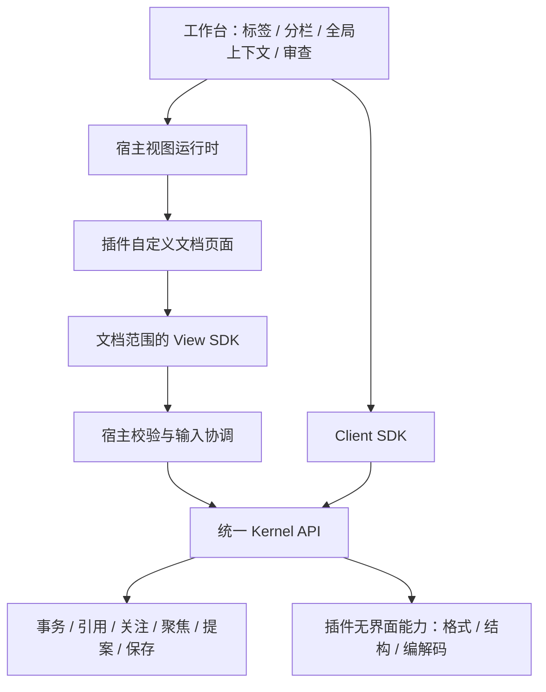

# 文档视图与插件页面 v1 草案

状态：**待实施设计**。这是架构 v0.3 新增的扩展契约，尚未实现插件页面运行时。依据 [架构总览](README.md)、[内核接口](kernel-api.md)、[插件协议](plugin-system.md) 和 [数据契约](contracts.md)。

## 1. 文件打开后的页面由插件决定

插件可以定义受支持文件在工作空间中的完整文档区域：布局、工具栏、编辑方式、阅读模式、局部面板、选取方式和键盘交互。它通过内核提供的引用、关注、聚焦、事务、提案等能力工作，而不是只能给固定编辑器提供一份预览数据。

例如 Markdown 插件可提供源码、阅读、双栏三个模式，以及标题导航、表格单元格点击、结构块多选；纯文本插件可提供连续文本或段落视图。这些均为待实现的插件设计，不表示 Demo 已有相应页面。

| 层 | 决定什么 | 具体例子 |
| --- | --- | --- |
| 内核 | 内容与通用业务规则 | 文档版本、事务、选区验证、引用快照、关注、聚焦、提案、撤销与保存编排 |
| 插件的无界面部分 | 文件含义与格式能力 | 识别、解码、编码、结构块、可选预览数据 |
| 插件的视图部分 | 当前文件的页面和交互 | 源码/阅读模式、自己的工具栏、点选段落、拖动、局部导航 |
| 工作台宿主 | 容纳文档页面的公共外壳 | 工作空间、标签、分栏、插件管理、全局上下文、模型发送确认、文件状态与审查入口 |
| 视图运行时 | 挂载 UI 和传递受限调用 | 页面容器、主题/语言/尺寸、生命周期、输入队列、消息桥和故障提示 |

插件拥有文档区域，不接管整个应用。全局保存状态、待确认提案和权限提示始终有宿主入口；插件可以增设本地入口，但不能靠隐藏按钮改变内核规则。引用、关注、聚焦的控件可以复用，也可以按文件类型自行设计，业务记录仍只有内核一份。



页面能使用浏览器组件不意味着内核依赖 DOM。内核只理解视图描述、绑定、选区及业务消息；具体组件树、光标像素、尺寸和渲染函数不进入内核。

## 2. 一个插件包，两类入口

新增 `document-view/v1`，与 `document-type/v1` 分离。同一个插件可以同时提供文件类型和一个或多个视图，也可以只提供其中之一。视图可以匹配别的插件已打开的文档，前提是模型、类型及版本契约相容。

```text
plugins/markdown/             # 拟议结构，尚未创建
  manifest.json
  core/                      # 无 DOM 的编解码、结构和命令
  views/web/                 # 页面、组件、局部样式与交互
  shared/                    # 普通纯函数，不注册插件
  test/
```

manifest 的顶层 `entry` 是可选的无界面入口；有无界面贡献时必填，纯视图插件可省略。视图入口放在对应贡献中，不从无界面入口导入。内核启用插件时登记视图描述，不执行视图入口；无 UI 的内核测试不能因此加载浏览器代码。插件的依赖图也不得让 core 间接导入 views。

```ts
interface DocumentViewContribution {
  kind: 'document-view/v1';
  id: string;
  title: string;
  matches: {
    models: string[];                 // 首期只可填 text/v1
    typeContributions?: string[];     // 如 editor.markdown/markdown
  };
  runtimes: Array<{
    kind: 'web-module/v1';
    entry: string;                    // 包内入口，非远程 URL
    viewSdk: string;                  // 支持的 SDK 版本范围
  }>;
  modes: Array<{ id: string; title: string; editable: boolean }>;
  selection: 'text-ranges/v1' | 'none';
}
```

若未填 typeContributions，只声明按模型匹配；填入时与 models 取交集。扩展名只用于类型识别，不能直接跳过解码和类型路由来打开视图。类型专属格式信息须有版本化 schema；否则视图只依赖通用 text/v1。

同包的所有入口与资产纳入安装校验和包摘要。宿主加载器只分发已启用、已绑定版本的本地包资产，不从文件正文、插件返回值或任意 URL 加载脚本；模块依赖也必须在已校验包闭包内。界面 CSP 和资源限制需由运行时落实，不要求为插件放开任意脚本或网络。

`PreviewTree/v1` 保留为可选的数据输出：便于通用阅读器、无 UI 测试或降级展示。它不再是插件页面唯一形态，也不限制插件使用自己的组件和交互。预览树的受限节点规则只约束该数据协议。

## 3. 打开和选择视图

1. `documents.open/import` 通过资源源和类型插件建立权威文档，固定 typeBinding。
2. `views.resolve` 根据已解码模型、类型绑定、已启用视图和宿主已登记运行时能力列出兼容候选；不执行 UI 代码。
3. 调用者显式选择，或采用仍有效的用户偏好/发行配置；只有一个兼容候选时可选用它。多个候选且无选择返回 `CAPABILITY_AMBIGUOUS`，不按安装顺序抢占。
4. 宿主调用 `views.open` 建立绑定并取得内核状态水位，以匹配的运行时加载包、创建文档范围通道和挂载页面。未完成状态同步前视图只读。
5. 运行时确认页面就绪；编辑模式必须获取当前文档写租约才开放输入，只读页面不需要输入租约。首次挂载不会自动加入关注或触发生成。

视图不存在或宿主不支持其运行时时，返回 `VIEW_UNAVAILABLE` 或 `VIEW_RUNTIME_UNSUPPORTED`；已解码文档继续留在内核。宿主可展示状态/取回正文的诊断面板，或让用户选择另一个已安装的兼容视图。诊断面板不冒充原格式编辑器，也不是内核隐含的文本插件。

一个 documentId 可以有多个 viewId，共享同一内核正文；同一资源打开成另一个 documentId 仍是独立缓冲区。切换页面模式或视图本身不会重新 decode、改变 typeBinding、自动迁移草稿或接受待确认提案；切换前排空的真实人工输入仍按既有输入策略处理，不能把它伪装成纯导航。

## 4. View SDK 与内核方法

View SDK 是 Plugin SDK 的视图入口，依赖公共 contracts；宿主 Client SDK 负责传输、投影和输入协调。视图拿到绑定到自身的 façade，不获得原始 Kernel.execute、管理员上下文或完整 Client SDK。下表是设计目录，不是已发布 SDK。

| View SDK 能力 | 对应内核能力 | 边界 |
| --- | --- | --- |
| document.get / snapshot / subscribe | documents.get / snapshot、受限事件订阅 | 只读自身文档及获准的派生状态，响应带版本/水位 |
| document.blocks / preview | documents.blocks / preview | 可选；无类型能力时明确不可用 |
| view.setMode | views.mode.set | 仅贡献已声明的 modeId，宿主协调输入后切换；返回有效可编辑性 |
| input.submit / flush | documents.transact | 显式人工输入，经过宿主队列、写租约与 expectedVersion；flush 不是内核业务方法 |
| selection.create / get / release | selections.create / get / release | 内核验证源范围，不从 DOM 或渲染文字猜正文 |
| context.get | context.*.list 的文档范围投影 | 当前文档相关的引用身份/关注/聚焦，不读取其他文档正文 |
| actions.request | context.*、documents.save/export/undo/redo、proposals.compare、commands.prepare | 受限枚举，先协调输入；需确认时交给宿主，不把确认票据交给插件 |
| environment.get / subscribe | 宿主运行时环境 | 主题、语言、尺寸、可用交互；不提供 OS 对象或文件访问 |
| ui.requestPanel | 宿主打开审查/上下文/模型面板 | 仅请求展示，不提交操作或授予新权限 |
| 生命周期回调 reveal | 宿主将当前文档的已验证 SourceAnchor 交给视图 | 宿主到视图的回调，非内核方法；只定位，不创建修改授权 |

`actions.request` 首期枚举为 reference.add/remove、attention.add/remove、focus.create/update/remove、document.save/export/undo/redo、proposal.compare、command.prepare。每个意图有独立 schema，映射到同名领域操作；不可包含任意 method、脚本或跨文档目标。引用/聚焦 ID 必须属于当前文档或由本视图获准创建的记录；历史引用移除的实际决策仍由内核核对。

插件自己的引用、关注和聚焦按钮可以发出上述请求；普通可逆动作不新增逐次弹窗。应用/放弃提案、发送模型、授权、关闭/丢弃草稿、安装插件等确认或全局操作由宿主入口处理。视图可请求打开相应审查 UI，不能自动提交确认。

新增调用角色 `plugin-view`。可信桥注入 principal、session、connection、viewId、文档范围、插件绑定和获批动作集合，插件提交的同名字段不能提升权限。桥转发时保留此来源及范围；宿主需要执行的输入协调或确认独立处理，不能把任意视图消息转换成宿主权限。视图只见自身范围内的事件，不能枚举其他工作区、引用正文、模型配置或凭据。`views.open/close` 只供宿主使用，插件不能自行创建新授权通道。

默认视图只有当前文档读取和环境能力；`view:input`、`view:context`、`view:commands` 等声明按具体动作列白名单，随插件启用获得宿主批准。各方法分别检验文档权限、类型能力与动作授权；人工输入还要求当前租约和可编辑模式。读取、选区与上下文动作不因没有输入租约而被拒绝，关注资格按文档权限判断，不按阅读页面的模式判断。内核再次校验，不依靠页面按钮是否禁用。

## 5. 视觉选择怎样变成引用、关注、聚焦

插件把页面上的操作映射为正文快照中的源范围。例如 Markdown 预览中的一个标题块、段落或表格单元格，可以映射到一个或多个原始 Markdown 范围。映射必须基于生成该页面的确切快照，不能用渲染后文本重新搜索位置。

```ts
interface SourceAnchor {
  documentId: string;
  snapshotId: string;
  version: number;
  kind: 'text-ranges/v1';
  ranges: Array<{ start: number; end: number }>;
}
type TextSelectionInput = SourceAnchor;
interface ValidatedSelection extends SourceAnchor {
  selectionId: string;
  ownerViewId: string | null;  // 无 UI 客户端则绑定其身份
}
```

范围使用 UTF-16 半开区间；必须非空、有界、不重叠、不切断代理对，且属于该视图获准读取的文档快照。内核提取 original，不信任插件另传的正文。选区有数量/大小/寿命限制；版本更新、视图关闭或授权撤销后不能再用于创建当前修改聚焦。

| 用户动作 | 内核行为 | 不产生的隐含效果 |
| --- | --- | --- |
| 在页面点选块、单元格或文字 | 校验并创建临时 selectionId | 不自动引用、关注、聚焦、发送或修改 |
| 添加引用 | 从明确的已确认文档快照生成独立 ReferenceSnapshot | 不获得编辑权限；首期仍是文档快照引用 |
| 添加关注 | 按文档能力/权限记录 Attention | 不自动选取局部范围；手选不代替关注 |
| 提交选区和说明为聚焦 | context.focus.create/update 消费 selectionId，生成内核 FocusGroup | 不自动关注；不能扩大到未选范围 |
| 点击已有聚焦卡片 | 宿主携快照与已验证范围让视图 reveal | 过期时显示旧快照详情，不把旧索引套在新正文 |

`selections.create` 只是校验数据来源和范围，内核无法从范围本身证明页面确实高亮了同一区域。自研视图需要映射测试；聚焦提交前必须可查看准确原文。转换会扩大到包含标记的整个语法块时，展示该范围并让用户明确选取；不能把“小格子”暗自换成整张表。

内核根据文档能力派生 target/reference 角色。可编辑文档的聚焦只有在文档被关注时才能用于修改；只读文档聚焦作参考。不支持精确映射的组件应禁用局部聚焦，或提供显式源码选区方式。新视图不能假定存在备用文本插件。

引用、聚焦最终记录保存自身快照与范围，不依赖 selectionId 或 viewId 生存。关闭视图只回收临时选区，已创建的记录仍遵循原文档/上下文生命周期。键盘 focus 是 UI 概念，与业务 FocusGroup 无关。

定位已有聚焦使用不含临时选区所有者的 SourceAnchor，由内核记录生成并按目标视图文档权限验证；不能要求新视图持有旧 selectionId。目标视图只支持当前正文时，宿主自行显示过期快照详情，不强制将历史原文挂进当前编辑器。

首期只支持 text/v1 的源范围。Markdown 表格单元格可定位到源码；真实电子表格单元格、图片区域、PDF 页面或二进制对象需要另外设计文档模型、selector、事务、差异、上下文序列化及编码契约，不能仅靠自定义 UI 宣称支持。

## 6. 编辑与自动修改分开处理

明确的人工输入可以来自按键、粘贴、勾选 Markdown 任务框、修改表格字段等插件交互。视图生成基于已确认版本的 TextChange，由内核统一提交、撤销和保存。普通人工编辑不要求文档已加入 AI 关注；关注约束模型/提案目标，不应阻止用户自己编辑文件。

自动生成、批量格式化或模型修改走 commands/runs → 候选 → 内核提案 → 宿主审查，沿用提案的关注/范围检查。渲染、挂载、滚动和切换模式不能偷偷提交 user-input；插件不得用该意图绕过提案规则。可信代码模式无法从消息证明真实用户手势，这也是审查和测试义务。

v0.4 补充：模型接入由 model-provider/v1 插件实现，模型可调用工具由 tool/v1 贡献；文件视图的 actions.request/commands 与模型工具是不同入口，不自动互相暴露。工具修改先暂存候选，由最终任务结果生成提案，页面不能将工具成功状态显示为已应用或已保存。具体见 [模型与工具契约](model-tools.md)。

插件可自定义修改效果展示，但应用资格、before/after、范围和版本由内核给出，宿主保留标准完整差异入口。不能把插件自己的展示缓存当作待保存正文。

## 7. 视图生命周期与未提交输入

内核保存轻量 ViewBinding：viewId、documentId、viewBinding、runtimeKind、宿主连接身份和有效权限；不保存 DOM 或组件实例。每次挂载建立新 viewId，宿主撤销旧通道并调用 views.close 后，旧消息全部拒绝。重连必须重新绑定，不能只凭旧 ID 恢复编辑。

宿主运行时的生命周期为 resolve → bind → load → mount → ready → dispose，可有 suspended/failed 状态；这些描述 UI 运行状况，不改变文档内容。Web 入口约定如下，均仅存在于宿主：

```ts
interface WebDocumentViewModule {
  mount(input: { container: HTMLElement; sdk: ViewSdk }): Promise<ViewInstance>;
}
interface ViewInstance {
  prepareToLeave(reason: string): Promise<{ ready: boolean; reason?: string }>;
  reveal(anchor: SourceAnchor): Promise<void>;
  dispose(): Promise<void>;
}
```

`prepareToLeave` 需将控件暂存变更送到 SDK；组合输入未结束返回待处理。插件的 ready=true 不足以放行，宿主还检查 SDK 队列为空、无在途事务、最后确认版本一致。主题/尺寸通过 SDK 环境订阅更新，内部模式与滚动等局部状态由视图保存；这些偏好不能携带正文作为隐蔽恢复存储。

同一文档在一个宿主内也只有一个输入拥有者。写租约绑定宿主连接及 writerId；视图模式下 writerId 对应 viewId，另一视图不能共用它提交输入。宿主保存/生成/审查入口通过拥有者的输入协调器排空队列，并以该租约处理内容操作；无 UI 客户端使用自己的 writerId。

只有阅读视图或没有视图时，宿主业务命令可申请短期 host-command 写租约，执行结束即释放，不让插件页面获得输入资格。有活跃输入拥有者时必须先协调，不能抢占。只读是页面模式时仍可对可编辑文档执行获准的保存/应用/撤销；文档本身只读则内容变更照常拒绝。模式切换经过 views.mode.set，先排空队列，转只读释放输入租约，转编辑重新申请；纯视觉选项无需进入该方法。

- 隐藏或移动标签可保留视图实例和租约，其他视图只读；需要暂停时先协调输入再释放。
- 换视图先处理旧控件输入/IME并确认事务，交接期间暂停旧视图新输入，再加载新视图的只读实例；同步就绪后释放旧租约，目标为编辑模式才获取新租约。失败保留旧页面并在权限有效时恢复输入；若租约已失效则重新同步，不能强行恢复写权限。
- 保存、生成、应用、撤销、关闭等读取或改变正文的动作均先经过当前输入拥有者；选区用于引用/聚焦时也需重新绑定到排空后的确认快照。
- 关闭视图撤销调用范围、释放其租约/订阅/临时选区，再清理 UI；不调用 documents.close，也不删除关注、已创建聚焦或引用。关闭文档需要原有 prepare/commit 流程并通知全部视图。

视图崩溃时保留内核最后确认正文和已有历史，撤销其通道与租约。宿主仍存活时可保留 SDK 已接收的待确认输入以供恢复，但插件控件中尚未送出的暂存文本、整页崩溃时的内存输入不保证恢复；不能声称零丢失。恢复必须核对事务 ID/版本，不重放未知结果的全文覆盖。

仅视图故障不自动隔离同包正常的无界面贡献；该视图实例失效即可。共享执行进程故障或完整插件故障按插件协议处理，不能承诺同进程故障隔离。升级/停用必须把活跃视图列为占用，先排空输入、关闭绑定，完成插件生命周期后再创建新视图；不热换正在编辑的组件。

## 8. 迁移方式与执行边界

首期选择受信自研插件的 `web-module/v1`：工作台提供文档容器，插件以自带组件和局部样式挂载。框架不进入内核契约；是否采用特定 UI 库在实现时另选。无需先建立插件市场或通用恶意代码沙箱。

| 宿主 | 复用部分 | 必要适配 |
| --- | --- | --- |
| 网站 | 内核、无界面插件、Web 视图包与 SDK | Web 视图运行时、HTTP/本地消息传输 |
| 有兼容 WebView 的应用 | 同一内核协议及 Web 视图包 | 经验证的 Web 运行时、宿主资源/IPC 桥、输入法与快捷键适配 |
| 嵌入其他应用 | 内核协议、格式能力；兼容时复用视图 | 明确尺寸、主题、焦点/快捷键归属、资源授权与消息身份 |
| 无 Web 运行时的原生宿主 | 内核、无界面插件和数据契约 | 自建兼容视图实现或增加 Web 容器；不能直接假定 Web UI 可运行 |

因此迁移单位是**内核 + 所选插件 + 对应运行时适配**。内核接口集中让各页面共享业务，视图入口独立让网页组件能单独复用；只复制零插件内核不会获得格式或页面能力。

首期同页面模块属于 trusted-code，View SDK 的窄接口是应用协议，不是恶意脚本隔离；插件代码不等于文件正文，原始 HTML、模型输出和文件里的脚本仍不得执行。插件仅能按协议操作自己的容器，不允许直接读其他页面、storage、网络或原生对象；同页面环境中的这些约束需要代码审查，不能虚称 SDK 已强制阻断。

若后续采用 iframe/WebView 隔离，须另设计来源、加载策略、专属消息通道和可验证的能力隔离，不能仅增加一个容器便声称安全。具体 sandbox、CSP、跨来源消息及原生桥策略留到运行时选型时依据官方规范核对，并用实际越权测试验证；本轮未完成该技术选型或隔离验证，不修改当前 Demo 的嵌入限制。

## 9. 第一条可验收切片

以同一份虚构 Markdown 文档验证：源码和阅读视图由独立插件页面实现；在阅读页点选两个不连续块，查看精确原文后填说明创建聚焦；显式加入关注，运行模拟、查看差异、应用、撤销、保存。换视图后复用同一版本和上下文，不重新识别文件。

必须覆盖：

- 零插件内核无视图贡献；无 UI 流程不加载 DOM/视图入口，纯视图插件不要求无界面 entry。
- 同一格式多个视图、匹配歧义、用户选择、缺运行时、视图与类型绑定独立。
- Unicode/重复文本/隐藏标记/表格映射、非连续范围、范围外不变、过期 selection、超限和越权 documentId。
- 点击或导航不自动关注/生成/应用；不关注仍可人工编辑，模型候选仍需关注及范围校验。
- 两视图单写租约、IME 和队列排空、切换失败、关闭视图不关文档、迟到消息、视图单独故障及插件升级。
- 网页与第二个兼容宿主复用相同插件页面和业务序列；真实键盘、输入法、主题、窄屏/缩放和焦点返回需实际验证。

验收必须分别报告内核协议、插件页面、宿主运行时和人工交互结果。Demo 的现有测试只能作回归依据，不能当作以上新能力已通过。
