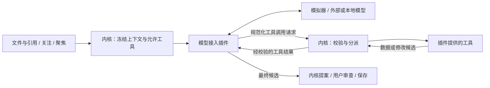

# 智能编辑上下文、模型插件与工具契约 v1 草案

状态：**待实施设计，架构 v0.4**。本轮明确职责和协议，不实现模型连接或工具运行时。关联：[总览](README.md)、[插件协议](plugin-system.md)、[内核接口](kernel-api.md)、[数据契约](contracts.md)。

## 1. 内核提供智能编辑环境，插件接入模型和工具

内核的主要职责是把文档、引用、关注、聚焦、版本和修改权限组织为统一的智能编辑上下文，向插件提供规定的操作接口，并接回修改候选。具体模型的连接、协议、消息格式、工具调用格式及兼容转换全部属于模型插件。

| 部分 | 职责 | 示例 |
| --- | --- | --- |
| 内核 | 上下文快照、授权范围、工具目录/分派、通用任务状态、结果校验、提案与保存 | 决定本次可读什么、可改哪里、哪些工具可调用 |
| 模型插件 `model-provider/v1` | 接入模型，转换请求/响应及工具协议 | 本地规则模拟、真实模型连接、结构化文本工具调用适配 |
| 工具贡献 `tool/v1` | 按规定 schema 实现可供模型调用的操作 | Markdown 结构查询、选中区块的修改候选 |
| 文件类型/视图插件 | 理解文件、呈现页面、文件专属交互，可同时贡献工具 | 一个 Markdown 包同时提供格式、页面和 Markdown 工具 |
| 宿主 | 页面与确认、资源/网络/凭据等平台机制 | 用户检查发送范围，实际网络请求与磁盘操作 |

模型插件与工具贡献是不同扩展点，不要求一个工具单独一个包。工具也可由独立插件提供；是否对某次模型任务可见由内核求交集。零插件时模型和工具目录均为空。



内核不包含某供应商的 SDK、请求模板、鉴权格式或对工具调用文本的猜测规则。`models.*` 管理插件配置，`runs.*` 管理任务和调用顺序；它们不构成内核自带模型接入。通用循环只处理标准消息、预算、取消和路由，模型如何得到下一步结果由插件负责。

## 2. 模型插件的统一步骤协议

将未实施草案中的单次 `generate` 修订为 `step`，支持无工具回答及工具往返；仍沿用尚未发布的 model-provider/v1 扩展名。正式发布后不得以同版本做破坏性修改。

```ts
interface ModelProvider {
  describeModels(): Promise<ModelDescriptor[]>;
  validateConfig(config: unknown): Promise<ConfigValidation>;
  step(input: ModelStepInput, context: OperationContext): AsyncIterable<ModelStepEvent>;
}
interface ModelStepInput {
  runId: string;
  executionId: string;              // 本任务中一个目标文档的执行
  stepIndex: number;
  modelProfile: ApprovedModelProfile; // 已批准模型实例/配置版本/目的服务，无裸凭据
  context: ApprovedEditingContext;  // 仅本次已批准的内容及范围
  tools: ApprovedToolDescriptor[];
  transcript: NormalizedTurn[];     // 该执行已接受的调用和结果
}
type ModelStepEvent =
  | { kind: 'delta'; text: string }
  | { kind: 'tool-calls'; calls: ToolCallRequest[] }
  | { kind: 'complete'; message: string; candidateIds: string[]; edits: CandidateEdit[] };
interface ToolCallRequest {
  toolCallId: string;
  toolId: string;                   // pluginId/局部贡献 ID
  arguments: unknown;
}
interface CandidateEdit {
  documentId: string;
  rangeId: string;
  replacement: string;
}
```

类型为协议草图，完整 DTO/schema 在实施时建立。每个 step 恰有一个终结事件：tool-calls 或 complete；不允许两者同时出现、终结后追加内容或无终结静默结束。delta 仅供显示，不触发工具或修改。调用参数须完整解析后再交内核，不能执行流式半截 JSON。取消/错误不是伪造的 complete。

modelProfile 由内核从已确认计划解析并逐步传入，不由模型回复指定；同一插件可服务多个配置实例，每个执行固定其模型标识、非敏感配置版本与目的服务。凭据只通过本次已批准端口使用，不能放进上下文或 transcript；执行中修改配置须重建计划。

模型插件声明执行模式 simulator/connected，以及工具支持 native/emulated/none。native 将供应商工具消息转换为上述 DTO；emulated 在插件内把规定工具描述转成该模型支持的结构化文本约定，再严格解析为相同 DTO；none 只产最终候选。缺少某次任务必需的工具支持时返回能力缺失，不悄悄跳过工具。

**离线模拟器与兼容适配不同。** simulator 使用固定规则且不联网；emulated 仍可能连接真实模型，需按 connected 显示目的服务与数据发送范围。解析失败返回结构错误或在预算内重试，不把任意自然语言、代码块或文件内容当作调用。格式适配不保证模型正确调用工具，须按模型独立验收。

插件可将相同协议接到不同模型，但不能暗自切换服务、添加另一模型处理用户正文、扩大内容或自动重发结果未知的计费请求。首期 connected 经已批准 Network/Credential 端口接入；未来本地进程/其他桥需另定受限 Host Port，不因“模型插件”身份获得任意进程执行权。

供应商需要的连续调用状态由模型插件按 executionId 隔离保管，受任务限额和清理约束；规范 transcript 由内核拥有。插件不得将其他任务或旧授权内容混入下一步；插件故障导致其续接状态丢失时终止该执行，不擅自重放请求。

## 3. 工具由插件声明与实现

新增独立于 command/v1 的 `tool/v1`。command/v1 面向用户/视图动作，不会自动暴露给模型；复用现有命令时也需显式工具声明、独立 schema 和范围校验。只靠命令名称或“只读”标签不能授权。

```ts
interface ToolContribution {
  kind: 'tool/v1';
  id: string;
  description: string;
  inputSchema: JsonSchema;
  outputSchema: JsonSchema;          // 约束返回的 data
  effect: 'read' | 'propose';
  readRequirement: 'approved-fragments' | 'target-document';
  documentModels: string[];
  typeContributions?: string[];
}
interface ToolHandler {
  invoke(arguments_: unknown, context: ToolOperationContext): Promise<ToolResult>;
}
interface ToolOperationContext {
  runId: string;
  executionId: string;
  toolCallId: string;
  binding: PluginBinding;
  scope: ApprovedToolScope;
  snapshots: ScopedSnapshotReader;  // 仅已批准快照/片段，不能读活动文档仓库
  signal: AbortSignal;
  limits: Readonly<ToolLimits>;
}
type ToolResult =
  | { effect: 'read'; data: unknown }
  | { effect: 'propose'; data: unknown; edits: CandidateEdit[] };
```

首期工具只读批准内容或生成候选，不直接写正文/磁盘，不取得网络、凭据、任意路径或原始 Kernel.execute。确需外部副作用的工具以后另设计授权与提交协议；不得通过声明新工具绕过。工具处理器本身不递归调用其他工具或模型，后续步骤由模型插件通过同一受控循环发起。

文件插件可用同包纯函数解析内容，但不能把当前完整文件悄悄塞进工具上下文。只批准聚焦片段时仅提供这些片段及原文位置；非连续片段保留各自边界，不能当作连续全文解析。需要全文结构的工具在缺少全文读取授权时不列入可用目录；只有另行确认上下文才能扩大。关注与修改权限不自动授权发送全文。

readRequirement 显式说明工具能否在片段上工作：approved-fragments 只依赖已批准片段，target-document 要求当前目标的完整快照已在计划中获准读取。它是可用性条件，不会自行申请或扩大权限；两种模式都只能读取明确共享的参考内容。允许读取全文也不增加可修改的 rangeIds。

内核验证结果 schema、effect、大小、文档/rangeId、版本和范围；effect=read 返回 edits 必须拒绝。data 及描述是有界数据，不可执行；其内容不构成授权指令。SDK 与 schema 无法证明受信代码绝无隐藏 I/O，沿用自研 trusted-code 的审查边界，不宣称已实现恶意插件沙箱。

## 4. 一次批准覆盖哪些上下文和工具

`plans.prepare` 从内核上下文构建 ApprovedEditingContext：请求、引用、关注目标、聚焦说明、版本化快照及精确目标范围。此对象不携带全工作区访问权。模型接入配置、已选工具及授权均是独立输入，不由文件内容或模型回复增加。

工具可用集合 = 已启用贡献 ∩ 模型工具支持 ∩ 文档模型/类型匹配 ∩ 本次可读/可提案范围 ∩ 宿主批准权限。用户或发行配置提供候选白名单，最终有效列表须在发送前可检查；运行中安装新插件不会自动增加工具。

计划冻结工具 ID、插件绑定/代次/配置、schema 摘要、effect、readRequirement、输入/输出与调用预算、可读范围和可修改 rangeIds；同已确认模型配置、目的服务及上下文一起纳入计划 hash。工具结果可能在后续步骤发送给该模型，这一数据流属于计划确认内容。范围内的只读/提案调用无需逐次弹窗；申请额外文件、范围、工具或服务需要新计划与确认。

每目标文档建立独立 executionId，其工具只能访问该执行的目标片段和明确共享的引用。关注列表中的其他文档不会自动成为参考。源文、权限、关注/聚焦或相关插件绑定改变时，取消/过期对应执行；单纯换页面仍不影响计划。只有实际依赖的工具插件变化才使该计划失效。

## 5. 工具往返和提案提交

1. 用户确认计划后，内核建立 run/execution，调用所选模型插件 step；插件处理实际模型通信或离线模拟。
2. step 返回 tool-calls 时，内核检查每次调用是否属于冻结目录及当前授权，校验参数和限额，再分派给对应插件 handler。首期按顺序执行，整个多步任务共享总时限和调用/字节预算。
3. 只读结果校验后作为 ToolReport 返回下一 step。提案工具的 edits 校验后暂存为 candidateId，报告包含候选 ID 和可查看的候选内容，明确尚未应用；真实正文、版本、脏状态不变。
4. 模型插件接收规范化 transcript（包括调用 ID、结果/错误和候选），按服务协议发起下一步。通用循环不推断供应商协议，也不自行决定新增工具。
5. complete 显式列出选用的 candidateIds 和可选直接 edits；未选候选丢弃。所有修改都基于批准的原始快照，不把前一工具候选当作已提交版本。重复/重叠范围拒绝，需模型选择或生成单一替代候选，不能按调用先后覆盖。
6. 同一 run 所有目标最终结果通过后才发布可审查提案；任一步失败/过期/取消不发布部分可应用结果。用户按文件应用到内核缓冲区，保存仍单独执行。

ToolReport 由内核产生，含 toolCallId、toolId、status=ok/error、经校验 data、可选 candidateId/edits 或脱敏 error.code；插件不能自行宣告调用已授权、提案已应用或文件已保存。完整结果只向所属执行/获准宿主可见，普通日志只留 ID、耗时、计数与状态。

调用去重键为 runId + executionId + toolCallId，并绑定 toolId/参数摘要。模型插件须把供应商 ID 映射到该执行内唯一 ID；同键同请求返回原状态/结果，正在执行时不能重复 dispatch，同键不同内容拒绝。终态或授权撤销后不再返回正文结果。未知响应不得启动新调用来冒充重试。

参数/未知工具等可恢复错误作为有界 ToolReport 反馈，模型可在剩余预算内提交新调用；协议损坏、插件失效、权限撤销、总时限/限额耗尽终止执行。取消后不接收迟到结果，不自动重新联网。原生或文本模拟的工具调用一视同仁，不能降低验证要求。

## 6. 公共 API 与插件桥

Kernel API 增加 `tools.list/describe`（查询候选目录及限制）和 `toolCalls.list/get`（查询获准任务的执行状态）；plans/runs 继续作为用户启动入口。目录可查询不代表调用获准。

模型请求通过 step 的标准 tool-calls 事件进入内核内部 ToolBroker；不把公共 Kernel API 整体转换成模型工具，不开放任意 `tools.invoke` 端点。模型插件只拿本次 OperationContext，工具处理器只拿 ToolOperationContext；可信调度器绑定 run/execution/调用和插件代次，不采信模型自报身份或授权。

`tool/v1` 的固定调用协议使工具实现与模型接入可独立替换。HTTP、IPC 或嵌入宿主使用同一 schema 和事件，不需要复制模型协议或工具权限规则。

## 7. 首条验收切片

先以虚构 Markdown 和纯文本验证：独立模型模拟插件发出结构查询 → 内核分派 Markdown 工具 → 返回批准范围内数据 → 模拟插件请求修改候选工具 → 选择 candidateId 完成 → 内核发布提案 → 用户应用/撤销/保存。模拟器与工具都是显式装配的独立贡献，零插件测试不得自动安装。

- 无模型插件仍可组织智能编辑上下文和文档；无工具插件时目录为空，支持无工具完成的模型仍可返回候选。
- 替换模型插件保持相同上下文/工具契约；native/emulated/none 和 simulator/connected 分别测试，连接其他模型的适配不能冒充离线模拟。
- 工具与用户命令分离；未授权工具、未知字段、伪造 run/range、全文越权、只读工具返回 edits、引用转目标均拒绝。
- 多轮预算、重复调用去重、无终结/多终结事件、半截参数、候选重叠、取消/迟到、工具升级、断线与正文变化均验证。
- 工具阶段不改缓冲区或磁盘；某目标失败无部分 pending；最终提案的范围外文本不变。

本轮未选择供应商、调用真实服务或实现协议。未来实际接入时再依据对应服务官方文档确定适配细节；现有 Demo 回归不代表工具链或真实模型接入已验收。
