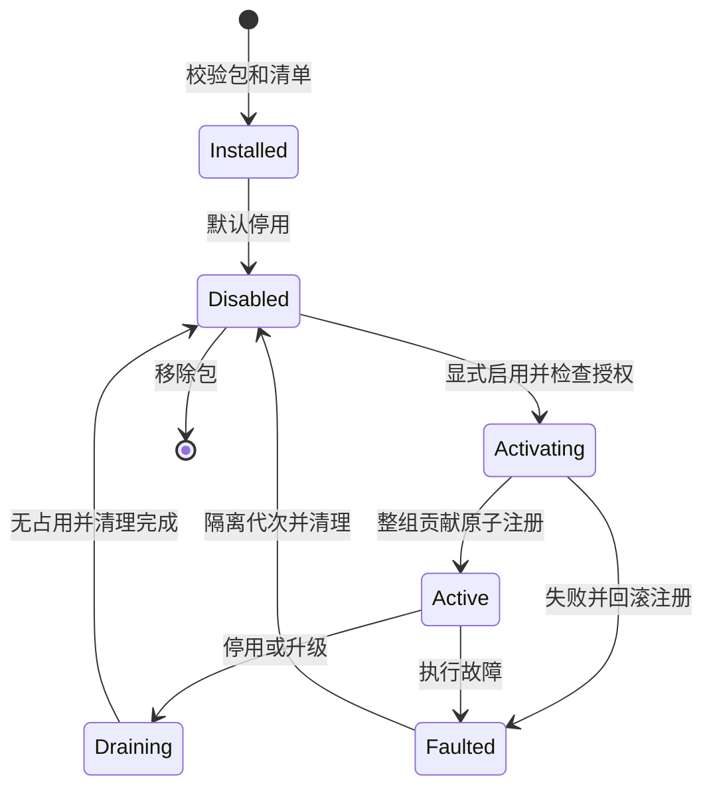

# 内核插件协议 v1 草案

状态：**待实施设计**。内核不自带任何插件，类型、资源源、模型插件单独设计、打包、注册和测试。见 [架构总览](README.md)、[Kernel API](kernel-api.md)。

## 1. 插件与宿主适配器

插件实现产品能力：Markdown 格式、本地资源协议、某种模型 API。宿主适配器实现平台机制：操作已授权文件句柄、受控网络请求、凭据存储、模块装载。两者不互相替代。

source-local 插件提出读取/条件写入某个已授权资源的请求，内核经 Host Ports 执行 OS 操作；插件无任意路径访问能力。内核拥有权限、版本、队列和提交的最终决策。插件不共享 kernel 内部对象引用；升级和移除不要求改内核源码，新增扩展点或文档模型才需要协议演进。

## 2. Manifest 与兼容性

Manifest 必须是可校验的 JSON 数据，以下使用类型表示字段；示例 ID 为拟定设计，不是已有插件包：

```ts
interface PluginManifest {
  manifestVersion: 1;
  id: string;                  // 如 editor.text
  version: string;             // 如 0.1.0
  displayName: string;
  kernelApi: string;           // 支持的语义版本范围
  pluginSdk: string;
  entry: string;               // 包根内模块，如 ./dist/index.js
  dependencies: Record<string, string>;
  activation: 'explicit';
  executionMode: 'trusted-code'; // 首期只支持审查过的受信代码
  contributes: ContributionManifest[];
  permissions: PermissionRequest[];
  settingsVersion: number;
  settingsSchema: JsonSchema;
}
```

editor.text 的贡献声明为 document-type/v1，局部 contributionId 为 text，documentModel 为 text/v1，扩展名为 .txt，操作为 decode/encode/blocks/preview，上下文能力 reference/attention/focus 为 true；permissions 为空。最终 contributionId 使用 pluginId + 局部 ID 构成唯一命名空间。

执行 entry 前，安装器校验清单、包摘要、入口路径、包大小、SDK/API 版本、依赖图、贡献 ID、schema 和权限请求。入口是包根内普通模块，不能用路径/链接/URL 逃逸；不运行安装脚本或联网寻找依赖。版本范围用实现时选定的语义版本解析库验证，不用字符串比较。

同 pluginId 每内核实例仅一个 active 版本；同 ID 不同摘要不得覆盖。依赖为版本固定的 DAG，缺失、循环、不兼容拒绝。普通工具库优先随包带入，避免不必要的运行时插件依赖。manifestVersion、插件版本、扩展点版本、settingsVersion、pluginGeneration 分别管理。

安装、启用、授权分开记录。plugins.install 只接收 Host PluginLoader 提供的 packageRef，普通界面/模型不能直接交任意磁盘路径或 URL。首期通过明确本地选择或可信发行清单装配，不做市场、自动下载和更新。

配置迁移处理副本，验证通过才提交；失败保留旧配置和包，不能把旧数据直接按新 schema 解释。

settingsVersion 表示配置结构版本，configRevision 表示配置实例的内容版本。修改解析、编码或模型配置使相关缓存和待执行计划失效；已有文档固定其类型配置绑定，只有显式重绑定才使用新配置，不重新 decode 或覆盖草稿。

## 3. 扩展点

| 扩展点 | 必须接口 | 输入/输出与校验 |
| --- | --- | --- |
| document-type/v1 | probe、decode；encode/blocks/preview 可选 | 有界元数据/前缀；text/v1 和格式元数据；无 encode 则不能原格式保存；全部输出须校验 |
| resource-source/v1 | describe、list、read、writeConditional；watch 可选 | opaque resourceId、版本与操作授权；校验工作区、身份、限额，内核按资源串行写入 |
| model-provider/v1 | describeModels、validateConfig、generate；estimateTokens 可选 | 本次批准输入 → 流/候选；无文档仓库、任意资源或凭据读取能力 |
| command/v1 | inputSchema、prepare、execute | 命名空间 commandId；输出数据、意图或提案，内核执行实际变更 |

类型的上下文能力只描述支持什么，不授予权限。资源权限、类型可编辑性、用户关注/范围、策略取交集形成实际能力；缺声明为 false。

类型路由先看用户显式绑定，再筛启用贡献和 probe 结果。多个有效候选返回 CAPABILITY_AMBIGUOUS，不能按安装顺序选。打开后固定 contributionId、pluginVersion、pluginGeneration，新装插件不重新解释已有文档。

probe 仅收内核提供的有界元数据/文件前缀，不能自取全文或联网；decode 再处理所选资源。资源源不判断格式，类型插件不拿路径授权。

首期无可执行 UI 插件、任意动态 API、工具执行或任意文档模型。插件命令位于 pluginId/commandId，经 commands.* 校验，不与内核方法重名，不执行传入的代码字符串。

## 4. Plugin SDK

```ts
interface PluginModule {
  activate(context: ActivationContext): Promise<PluginInstance>;
}
interface PluginInstance {
  contributions: ContributionHandlers;
  deactivate(context: { reason: string; deadlineMs: number }): Promise<void>;
}
interface OperationContext {
  operationId: string;
  sessionId: string;
  pluginGeneration: number;
  signal: AbortSignal;
  limits: Readonly<OperationLimits>;
  progress(update: PluginProgress): void;
  resources?: ScopedResourcePort;
  network?: ApprovedRequestPort;
  settings: ReadonlyPluginSettings;
}
```

这是 SDK 外观；跨进程时 signal、progress、端口调用映射到消息，不序列化函数。ActivationContext 仅有配置视图、日志、注册和清理，不含会话正文、文件或网络；activation 不读文件/连接模型。每次调用才创建 OperationContext，端口按扩展点/本次授权提供，不默认全有。

插件只收不可变快照/副本，不能拿 DocumentStore、撤销历史、Kernel execute、全局网络、文件系统或裸凭据。ID 与句柄按会话和操作绑定，不能从前一次调用带到新授权外。

## 5. 权限与可信执行边界

有效授权 = manifest 所需权限 ∩ 宿主批准范围 ∩ 用户本次操作范围。升级新增权限须独立批准，不能继承扩大；缺权限、端口或停用状态明确报错。

- 类型插件默认无 I/O，只处理提供的字节和正文。
- 资源源只使用某工作区的 opaque 授权，内核在读取/提交前复核，OS 端口落实路径、链接和平台检查。
- 模型只使用已确认 modelProfile 的端点和本次内容；网络代理限制目标、方法、大小、重定向、解析地址变化、超时。
- 凭据驻宿主安全存储或内存；模型提交请求描述，网络代理在已批准目标的请求中注入 credentialRef 对应凭据。插件无明文密钥读取；特殊认证需另设计，不能提供通用读密钥捷径。
- 日志默认仅 ID、错误码、耗时和计数，不能含正文、提示词、密钥、路径或未过滤外部错误。

**SDK 不是 JavaScript 沙箱。** 首期 trusted-code 模式只运行人工审查的自研本地插件。同进程恶意模块可能绕过 SDK；普通 Worker/子进程也不能单独证明文件和网络隔离。不加载未知来源代码，不宣称任意第三方代码安全。

PluginLoader/ExecutionHost 为独立进程、能力代理和 OS 约束预留端口。开放第三方前验证真实隔离、资源回收、进程终止和越权测试；未实现的模式返回 UNSUPPORTED_EXECUTION_MODE。自研插件仍走同一逻辑协议，trusted-code 说明运行信任，不增加应用权限。

## 6. 生命周期



成功激活创建新 pluginGeneration，所有 handler/schema 验证后才一次发布；失败不留半注册，重复启用幂等。旧代次迟到结果不能影响新实例。

停用/升级 prepare 返回依赖文档、快照、提案、计划、活动 I/O 和下游插件清单，处理占用后才 commit。默认有占用返回 PLUGIN_BUSY。保存进入不可逆提交段时等待确定结果，不能返回已取消后继续写盘。

清单须区分“需要活动代码的占用”和“仅保存来源信息的历史记录”：正在使用的类型文档、计划和 I/O 会阻塞停用；只含正文/版本的历史快照不持有插件代码。经用户处理后，相关 pending 变 expired，历史快照仍能以通用文本查看；不能因为历史里有 pluginId 就永久无法卸载。

用户可以先导出/关闭，或明确将文档脱离插件转为内存 text/v1：保留正文/历史，撤销旧格式编码、预览和保存能力。变更绑定使相关计划过期；不能把降级状态当作原格式可安全写回。保住内核现有正文不得依赖故障插件；核心可提供内存文本取回，不冒充原文件编码导出。

故障立即隔离该代次，取消尚可取消的调用，保留最后确认正文；缺类型能力时只读展示已有 text/v1，不清空草稿或自动换插件。保存结果未知则保留 operationId 并重读资源版本，不能假报成功。

升级不直接热换：旧版 drain/停用，副本配置迁移，新版启用成功后原子发布。失败恢复验证过的旧版/配置，也创建新代次；注册/配置可回滚，已写文件和已发模型请求不可宣称撤销。依赖拓扑启动、逆序停止，被依赖项不能单独消失。

## 7. 跨宿主预览

类型插件返回 PreviewTree/v1，而非 DOM、React、HTML 字符串或脚本。受限节点包括 text、paragraph、heading、list、quote、table、code、link、separator；文字为字面值，链接由内核校验、宿主仅在用户操作后打开。未知节点回退源码。

原始 HTML 按文本显示，图片默认不加载，Mermaid 首期保留源码。树深、节点数、表格和总量有界；网页/桌面只实现通用渲染器，不重复 Markdown 解析。

结构与预览由同一解析结果派生，分块保留原文/空白和 sourceRange。预览不回写正文；格式化或修复必须作为独立命令产出提案。

## 8. 首批插件设计卡

| 包 | 输入输出 | 独立验收 |
| --- | --- | --- |
| editor.text | UTF-8 字节 ↔ text/v1 + 格式元数据；段落/文本树 | Unicode、BOM、LF/CRLF/CR、混合只读、非法字节、NUL、限额、空白 |
| editor.markdown | 字节 ↔ text/v1；结构/预览树 | Demo 分块与预览、表格列表围栏、非连续原文、无 DOM 运行 |
| editor.source.local | 授权资源 ↔ 分页目录/字节/opaque revision | 越界、链接、别名、外部修改、并发写、权限失败、临时文件、结果不确定 |
| editor.model.simulator | 批准的范围/说明/参考 → 候选 | 固定规则、模拟标记、零网络、只改关注、范围外不变 |
| 首个真实模型插件 | 经确认输入 → 有界事件/候选 | 假服务异常、取消、结构、未知范围、凭据不泄露，真实服务另验 |

每个包有自己的 README、manifest、schema、实现、虚构夹具、权限说明、兼容矩阵。零插件测试不能暗装这些包；完整演示由发行清单显式启用。

## 9. 完成标准

- kernel 依赖闭包和启动路径无具体插件，空注册表可运行，无后台自动装配。
- 同插件组合可接至少两种宿主，输出一致，缺平台端口明确降级。
- 缺依赖、循环、版本冲突、重复贡献、路由歧义、激活失败不留半注册。
- 卸载、升级、崩溃、迟到结果不丢草稿，不跳过范围或版本检查。
- 预览、命令和模型候选全部经内核验证，作者为本项目不例外。
